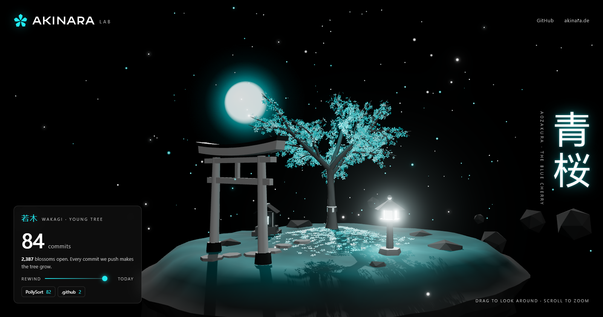

# 青桜 · aozakura

The landing page of [Akinara-Lab](https://github.com/Akinara-Lab): a blue cherry
tree on a floating island, rendered with three.js. **The tree grows with every
commit** pushed to the organisation's repositories.



## How the tree grows

The tree is generated from a fixed seed, so it is always the same tree, just
older. One number drives everything:

```
age = c^0.6 / (c^0.6 + 17)        c = commits across all repositories
```

Early commits make a visible difference, later ones add twigs and blossoms, and
the tree never quite finishes. Blossoms sit on young wood only, so they move
outwards as the branches thicken. The stages are 種 seed, 芽 sprout, 若木 young
tree (up to roughly 110 commits), 成木 grown tree (about 540), 古木 old tree
(about 2,700) and 神木 sacred tree.

The slider rewinds the tree to any earlier commit count.
`?commits=5000` previews any size, `?still` skips the animation.

## Where the number comes from

- `scripts/build-stats.mjs` counts the commits on the default branch of every
  repository and writes `data/stats.json`. The deploy workflow runs it on every
  push and every six hours.
- On top of that the page asks the public GitHub API once per visit, so a fresh
  push shows up without waiting for the next deploy.
- Private repositories are counted only if the repository secret
  `ORG_STATS_TOKEN` holds a token that may read them. Their names are never
  published, only the total.

## Run it locally

```
node scripts/dev-server.mjs
```

and open <http://localhost:4173>. No build step and no dependencies to install;
three.js is vendored in `vendor/three` (MIT licence), so the page loads nothing
from third-party servers.

| File | What it does |
| --- | --- |
| `src/tree.js` | skeleton, bark, blossoms, falling petals |
| `src/scenery.js` | island, torii, lantern, shrine, sky, lights |
| `src/main.js` | renderer, camera, growth animation, panel |
| `src/stats.js` | commit count (snapshot, live API, preview) |
